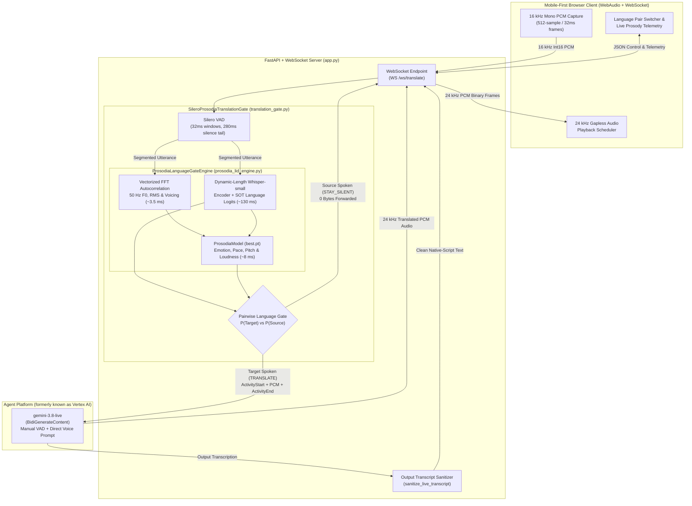
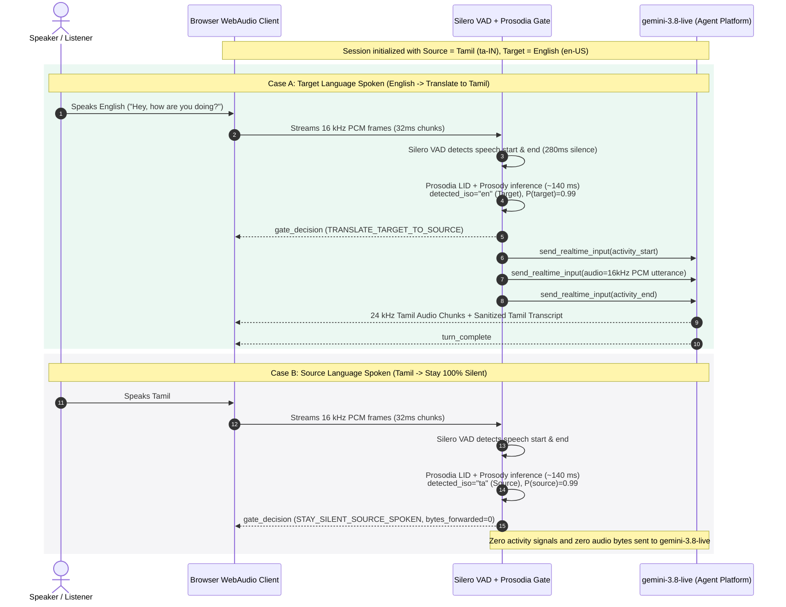

# Gemini Live Translation (Unidirectional)

Real-time unidirectional speech-to-speech interpreter powered by **Prosodia** (`audio-jevlike` paralinguistic prosody + `openai/whisper-small` language identification) and **Gemini 3.8 Flash Live** (`gemini-3.8-live`) on **Agent Platform (formerly known as Vertex AI)**.

---

## Overview

Traditional bidirectional voice agents respond to every utterance in the room. In a unidirectional interpretation scenario, a listener selects their **Source** language (the language they understand) and a **Target** language (the foreign language being spoken):

1. **When the Target language is spoken**: The Prosodia Language Gate identifies the utterance as the Target language (`TRANSLATE_TARGET_TO_SOURCE`), frames the utterance with Manual Voice Activity Detection (`ActivityStart -> 16 kHz PCM -> ActivityEnd`), and streams it to `gemini-3.8-live` on **Agent Platform (formerly known as Vertex AI)**, which synthesizes natural first-person speech in the **Source** language (`24 kHz` PCM audio + native-script transcript).
2. **When the Source language is spoken**: The Prosodia Language Gate identifies the utterance as the Source language (`STAY_SILENT_SOURCE_SPOKEN`) and drops the audio at the edge (`0 bytes` forwarded to `gemini-3.8-live`), guaranteeing **100% deterministic silence** with zero model turns or token consumption.

---

## System Architecture

### 1. High-Level Component Architecture



### 2. Real-Time Unidirectional Gate Sequence



---

## Key Engineering Highlights

* **Low-Latency Prosodia LID & Prosody Engine (`~135 to 175 ms` CPU)**:
  * **Vectorized FFT Autocorrelation Prosody Extractor** ([`fast_extract_prosody_tensor`](file:///prosodia_lid_engine.py)): Computes 50 Hz fundamental frequency (`F0`), RMS energy, and voicing probability in `~3.5 ms` using stride tricks and RFFT autocorrelation instead of slow iterative `librosa.pyin`.
  * **Dynamic-Length Whisper Encoder** ([`_fast_whisper_encode`](file:///prosodia_lid_engine.py)): Slices only the active speech window (`<= 2.2s` + `0.8s` native silence tail) instead of padding to 30 seconds (`3,000` mel frames), reducing CPU encoder latency by `8.7x` while preserving accuracy across 16 languages.
  * **Paralinguistic Prosody Conditioning** ([`ProsodiaModel`](file:///prosodia/model/prosodia.py)): Extracts speaker emotion, speaking rate (`slow` / `medium` / `fast`), pitch contour (`falling` / `level` / `rising`), and loudness (`soft` / `normal` / `loud`) from `model/best.pt`.
* **Deterministic Silence via Manual VAD**:
  * Configures `gemini-3.8-live` with `AutomaticActivityDetection(disabled=True)` and `TurnCoverage.TURN_INCLUDES_ONLY_ACTIVITY`.
  * `gemini-3.8-live` never sees raw microphone audio until the Prosodia gate explicitly verifies that the spoken utterance is in the selected Target language.
* **Uninterrupted First-Person Translation & Transcript Sanitizer**:
  * Uses a structured first-person interpreter instruction ([`build_translation_system_instruction`](file:///translation_gate.py)) so `gemini-3.8-live` speaks directly as the voice of the speaker in the Source language without assistant meta-commentary or premature 1-second chunk truncation.
  * Includes [`sanitize_live_transcript`](file:///translation_gate.py) to strip any internal speech-to-speech control markers from streamed transcriptions.

---

## Supported Languages (16 BCP-47 Locales)

| Locale Code | Language Name | ISO-639-1 | Whisper Token |
| :--- | :--- | :--- | :--- |
| `en-US` | English (US) | `en` | `<\|en\|>` |
| `en-IN` | English (India) | `en` | `<\|en\|>` |
| `hi-IN` | Hindi (India) | `hi` | `<\|hi\|>` |
| `bn-BD` | Bengali | `bn` | `<\|bn\|>` |
| `ta-IN` | Tamil (India) | `ta` | `<\|ta\|>` |
| `te-IN` | Telugu (India) | `te` | `<\|te\|>` |
| `mr-IN` | Marathi (India) | `mr` | `<\|mr\|>` |
| `es-US` | Spanish (US) | `es` | `<\|es\|>` |
| `fr-FR` | French (France) | `fr` | `<\|fr\|>` |
| `de-DE` | German (Germany) | `de` | `<\|de\|>` |
| `ja-JP` | Japanese (Japan) | `ja` | `<\|ja\|>` |
| `ko-KR` | Korean (Korea) | `ko` | `<\|ko\|>` |
| `pt-BR` | Portuguese (Brazil) | `pt` | `<\|pt\|>` |
| `ar-EG` | Arabic (Egypt) | `ar` | `<\|ar\|>` |
| `it-IT` | Italian (Italy) | `it` | `<\|it\|>` |
| `ru-RU` | Russian (Russia) | `ru` | `<\|ru\|>` |

---

## Repository Structure

```text
.
├── app.py                        # FastAPI + WebSocket server bridging browser, Prosodia gate, and gemini-3.8-live
├── translation_gate.py           # SileroProsodiaTranslationGate, LiveConnectConfig builder, and transcript sanitizer
├── prosodia_lid_engine.py        # High-speed Prosodia + Whisper-small Language Identification & Prosody engine
├── prosodia/                     # Prosodia neural architecture (audio-jevlike encoders, projector, multi-task heads)
├── model/                        # Trained Prosodia checkpoint (best.pt) and acoustic tertile binner (bins.json)
├── sample_audio/                 # 16 kHz mono WAV reference clips for automated unit and functional tests
├── static/                       # Mobile-first minimal web client (index.html, styles.css, app.js)
├── tests/                        # Unit and end-to-end functional test suites
│   ├── test_unit_prosodia_lid.py
│   ├── test_unit_translation_gate.py
│   └── test_functional_app_and_live_geap.py
├── Dockerfile                    # Production container definition with pre-baked model weights
└── requirements.txt              # Python package dependencies
```

---

## Configuration & Environment Variables

No credentials or project IDs are hardcoded in this repository. Configure runtime settings via environment variables:

| Variable | Description | Default |
| :--- | :--- | :--- |
| `GOOGLE_CLOUD_PROJECT` | Google Cloud project ID with Agent Platform (formerly known as Vertex AI) enabled | Inferred from ADC if unset |
| `GOOGLE_CLOUD_LOCATION` | Agent Platform region for `gemini-3.8-live` | `us-central1` |
| `GOOGLE_APPLICATION_CREDENTIALS` | Optional path to a local service account JSON key file (prefer `gcloud auth application-default login` ADC) | Unset (uses ADC) |
| `GEMINI_LIVE_MODEL` | Live API model identifier on Agent Platform | `gemini-3.8-live` |
| `PORT` | HTTP/WebSocket listening port | `8092` (`8080` in Docker) |

---

## Local Development

### 1. Authenticate with Google Cloud ADC

```bash
gcloud auth application-default login
export GOOGLE_CLOUD_PROJECT="your-gcp-project-id"
export GOOGLE_CLOUD_LOCATION="us-central1"
```

### 2. Install Dependencies & Start Server

```bash
pip install -r requirements.txt
python3 app.py
```

Open `http://localhost:8092` in your desktop or mobile browser.

---

## Running Tests

Run the unit and functional test suite with `pytest`:

```bash
export GOOGLE_CLOUD_PROJECT="your-gcp-project-id"
pytest -v tests/
```

* `tests/test_unit_prosodia_lid.py`: Verifies pairwise language identification, paralinguistic prosody extraction, and sub-180ms inference latency across English, Hindi, Bengali, and Tamil speech samples.
* `tests/test_unit_translation_gate.py`: Verifies Agent Platform wire serialization, transcript sanitization, and Manual VAD framing (`ActivityStart -> PCM -> ActivityEnd` on Target speech; `0` calls on Source speech).
* `tests/test_functional_app_and_live_geap.py`: Verifies REST endpoints and end-to-end WebSocket translation and silence gating against `gemini-3.8-live` on Agent Platform (formerly known as Vertex AI).

---

## Deploying to Google Cloud Run

The included `Dockerfile` pre-bakes the `openai/whisper-small`, `all-MiniLM-L6-v2`, `ProsodiaModel` (`best.pt`), and `silero-vad` weights into the container image for zero cold-start downloads:

```bash
gcloud run deploy gemini-live-translation \
  --source=. \
  --region=us-central1 \
  --project="your-gcp-project-id" \
  --set-env-vars="GOOGLE_CLOUD_PROJECT=your-gcp-project-id,GOOGLE_CLOUD_LOCATION=us-central1" \
  --allow-unauthenticated \
  --cpu=4 \
  --memory=4Gi \
  --timeout=3600 \
  --min-instances=1 \
  --max-instances=5
```
